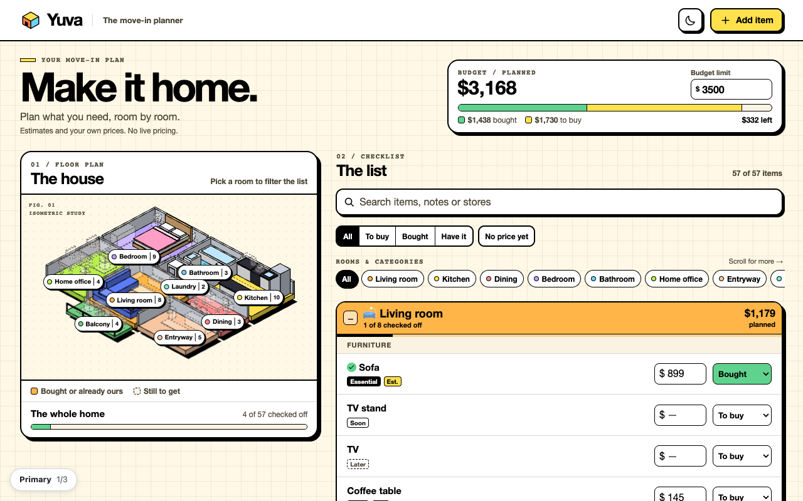

# Yuva — a move-in planner

**Yuva** means “nest” or “home” in Turkish. It helps you turn a move into a room-by-room checklist: what you still need, what you already have, and what you can afford. In the full versions, the isometric house fills with furniture as you check off items.

[Open Yuva](https://hilalys.github.io/yuva/) · [Compare the designs and watch the demos](https://hilalys.github.io/yuva/review/)

[](https://hilalys.github.io/yuva/?v=primary)

## Three ways to plan a move

| Version | What to try | Silent demo |
| --- | --- | --- |
| [**Primary**](https://hilalys.github.io/yuva/?v=primary) | Scroll the full-page checklist while the floor plan stays in view on desktop. Pick the kitchen and mark the espresso machine bought. | [Watch Primary (0:40)](https://hilalys.github.io/yuva/review/demos/yuva-primary.mp4) |
| [**Modern**](https://hilalys.github.io/yuva/?v=modern) | Explore the same checklist and floor plan in a quieter layout. Mark an item “Have it” and see how it affects your budget. | [Watch Modern (0:40)](https://hilalys.github.io/yuva/review/demos/yuva-modern.mp4) |
| [**Basic**](https://hilalys.github.io/yuva/?v=basic) | Choose a home size, household size, and whether kids or pets are moving in. Yuva generates a checklist without pricing or a floor plan. | [Watch Basic (0:40)](https://hilalys.github.io/yuva/review/demos/yuva-basic.mp4) |

Use the version picker or the `[` and `]` keys to switch. Each version saves its progress separately in the current browser. No accounts or server are needed. Starter prices are estimates, not live quotes; “Have it” items don't count as spending. Primary and Modern use a fixed floor plan.

## About the workshop

Yuva began with a couple setting up a home in Seattle. It became a design exercise for the **AI-First Design Workshop (UXPA Seattle)**: how much help should a move-in planner offer before it starts getting in the way?

The project used a design system and a prompt playbook to turn one brief into three working prototypes. Primary follows the original cut-paper style; Modern explores a different visual hierarchy without dropping the core tools; Basic tests what can be removed entirely. The comparison page lets you try the same kitchen checklist task across all three.

## Run locally

Yuva uses plain HTML, CSS, JavaScript modules, and SVG. No dependencies or build step are needed. From the repository root, run:

```sh
python3 -m http.server 8000 --bind 127.0.0.1
```

Open [the app](http://127.0.0.1:8000/) or [the comparison page](http://127.0.0.1:8000/review/). Shared starter items, budget calculations, and browser persistence live in [`model.js`](./model.js); the three versions live under [`labs/`](./labs/).


